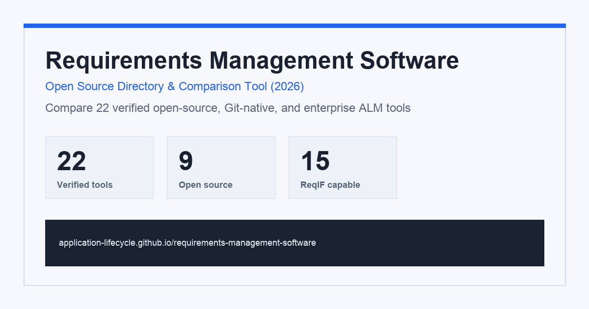

<div align="center">

# Requirements Management Software — Open Source Directory & Comparison Tool (2026)

**An unbiased, structured directory comparing 22 open-source and commercial requirements management software tools — filterable by engineering job, ReqIF support, Git workflow, compliance standards, and pricing.**

[](#-complete-requirements-management-software-directory-2026)
[](#-open-source-requirements-management-software)
[](#-capability--reqif-comparison-matrix)
[](LICENSE)

[**Interactive Web Directory** →](https://application-lifecycle.github.io/requirements-management-software/) • [**Quick Decision Matrix**](#-quick-decision-matrix-by-user-job) • [**Open Source Tools**](#-open-source-requirements-management-software) • [**Commercial & Enterprise ALM**](#-commercial--enterprise-requirements-management-software) • [**Interactive CLI**](#-interactive-cli-comparison--matcher) • [**Submit a Tool via PR**](#-propose-a-new-tool-via-github-pull-request)

</div>



---

## Why This Directory Exists

Teams searching for **requirements management software** usually hit biased vendor listicles or outdated spreadsheet dumps. Depending on your engineering workflow, you do not need the same tool:

- **Docs-as-code / Git-native software teams** want requirements stored in Markdown, YAML, or SDoc alongside source code and reviewed in Pull Requests.
- **Regulated & safety-critical teams** (ISO 26262, IEC 62304, DO-178C, FDA 21 CFR Part 11, ASPICE) need end-to-end traceability matrices, immutable baselines, electronic sign-off, and ReqIF exchange.
- **Agile & DevOps teams** want hierarchical requirements and test coverage inside Jira, Azure DevOps, or GitLab without heavy legacy desktop clients.

This repository maintains a verified JSON dataset ([`tools.json`](tools.json)), an interactive GitHub Pages directory ([`docs/index.html`](docs/index.html)), and a zero-dependency Python CLI ([`rm_advisor.py`](rm_advisor.py)) to help you **evaluate, filter, and pick** the right software.

---

## Quick Decision Matrix by User Job

| Your Job / Engineering Context | Top Recommended Tools | Why It Fits | Links |
| :--- | :--- | :--- | :--- |
| **Git-Native & Docs-as-Code (Open Source)** | **StrictDoc** / **Doorstop** | Plain-text SDoc or YAML in Git, PR reviews, CI traceability checks, zero license cost | [StrictDoc](https://github.com/strictdoc-project/strictdoc) • [Doorstop](https://github.com/doorstop-dev/doorstop) |
| **Lightweight ReqIF Without Heavy Server** | **ReqView** / **Eclipse RMF** | Native ReqIF import/export, tabular DOORS-style view, offline or Git-friendly JSON | [ReqView](https://www.reqview.com/) • [Eclipse RMF](https://github.com/eclipse/rmf) |
| **Automotive, Aerospace & Defense ALM** | **Jama Connect** / **Codebeamer** / **Polarion** / **IBM DOORS Next** | Full V-model traceability, variant management, ISO 26262 / DO-178C / ASPICE audit packs | [Jama](https://www.jamasoftware.com/platform/jama-connect/) • [Codebeamer](https://www.ptc.com/en/products/codebeamer) • [Polarion](https://plm.sw.siemens.com/en-US/polarion/) |
| **Medical Device QMS (IEC 62304 / FDA)** | **MatrixALM** / **Jama Connect** / **SpiraTeam** | Purpose-built design controls, risk FMEA, and 21 CFR Part 11 signatures | [MatrixALM](https://www.matrixreq.com/) • [SpiraTeam](https://www.inflectra.com/SpiraTeam/) |
| **Jira or Azure DevOps Native** | **R4J** / **Modern Requirements4DevOps** | Adds tree hierarchies, baselines, and suspect-link matrices directly inside Jira or ADO | [R4J](https://easesolutions.com/r4j-requirements-management-for-jira/) • [Modern Req](https://www.modernrequirements.com/) |
| **Agile PRDs & Self-Hosted Product Tracking** | **Plane** / **GitLab Requirements** | Modern self-hosted issue/PRD workspace or CI-linked GitLab requirements | [Plane](https://github.com/makeplane/plane) • [GitLab](https://docs.gitlab.com/ee/user/project/requirements/) |

---

## Open Source Requirements Management Software

| Tool | License | Deployment | ReqIF | Traceability | Git Native | Official Site | GitHub |
| :--- | :--- | :--- | :---: | :---: | :---: | :--- | :--- |
| **StrictDoc** | Apache-2.0 | Local CLI, Self-Hosted | Yes | Yes | Yes | [strictdoc.readthedocs.io](https://strictdoc.readthedocs.io/) | [strictdoc-project/strictdoc](https://github.com/strictdoc-project/strictdoc) |
| **Doorstop** | LGPL-3.0 | Local CLI | No | Yes | Yes | [doorstop.readthedocs.io](https://doorstop.readthedocs.io/) | [doorstop-dev/doorstop](https://github.com/doorstop-dev/doorstop) |
| **Sphinx-Needs** | MIT | Local CLI, Self-Hosted | Yes | Yes | Yes | [sphinx-needs.com](https://sphinx-needs.com/) | [useblocks/sphinx-needs](https://github.com/useblocks/sphinx-needs) |
| **TReqs** | MIT | Local CLI | No | Yes | Yes | [treqs-on-git.github.io](https://treqs-on-git.github.io/) | [treqs-on-git/treqs-ng](https://github.com/treqs-on-git/treqs-ng) |
| **Eclipse RMF (ProR)** | EPL-2.0 | Desktop | Yes | Yes | Yes | [eclipse.dev/rmf](https://eclipse.dev/rmf/) | [eclipse/rmf](https://github.com/eclipse/rmf) |
| **Plane** | AGPL-3.0 | Cloud, Self-Hosted | No | No | Yes | [plane.so](https://plane.so/) | [makeplane/plane](https://github.com/makeplane/plane) |
| **Redmine** | GPL-2.0 | Self-Hosted | No | No | Yes | [redmine.org](https://www.redmine.org/) | [redmine/redmine](https://github.com/redmine/redmine) |
| **OSRMT** | GPL-2.0 | Desktop, Self-Hosted | No | Yes | No | [sourceforge.net/projects/osrmt](https://sourceforge.net/projects/osrmt/) | [osrmt/osrmt](https://github.com/osrmt/osrmt) |

---

## Commercial & Enterprise Requirements Management Software

| Tool | Category | Pricing Model | ReqIF | Compliance Standards | Official Website |
| :--- | :--- | :--- | :---: | :--- | :--- |
| **ReqView** | Systems / Git-JSON | Free Viewer / ~$29/user/mo | Yes | ISO 26262, IEC 62304, DO-178C, FDA 21 CFR Part 11 | [reqview.com](https://www.reqview.com/) |
| **Jama Connect** | Enterprise ALM | Custom Enterprise Quote | Yes | ISO 26262, DO-178C, IEC 62304, FDA 21 CFR Part 11, ASPICE | [jamasoftware.com](https://www.jamasoftware.com/platform/jama-connect/) |
| **IBM DOORS Next** | Enterprise ALM | Custom Enterprise Quote | Yes | ISO 26262, DO-178C, ASPICE, MIL-STD | [ibm.com](https://www.ibm.com/products/requirements-management) |
| **Siemens Polarion** | Enterprise ALM | Custom Enterprise Quote | Yes | ISO 26262, DO-178C, IEC 62304, FDA 21 CFR Part 11, ASPICE | [plm.sw.siemens.com](https://plm.sw.siemens.com/en-US/polarion/) |
| **PTC Codebeamer** | Enterprise ALM | Custom Enterprise Quote | Yes | ISO 26262, DO-178C, IEC 62304, ASPICE | [ptc.com](https://www.ptc.com/en/products/codebeamer) |
| **Visure Requirements ALM** | Enterprise ALM | Custom Quote / Trial | Yes | ISO 26262, DO-178C, IEC 62304, EN 50128 | [visuresolutions.com](https://visuresolutions.com/) |
| **Perforce Helix RM** | Enterprise ALM | Custom Quote | Yes | ISO 26262, IEC 62304, FDA 21 CFR Part 11 | [perforce.com](https://www.perforce.com/products/helix-alm) |
| **Modern Requirements4DevOps** | Azure DevOps | From ~$35/user/mo | Yes | FDA 21 CFR Part 11, ISO 13485, IEC 62304 | [modernrequirements.com](https://www.modernrequirements.com/) |
| **R4J (Requirements for Jira)** | Jira Marketplace | Tiered Marketplace | Yes | ASPICE, ISO 26262 | [easesolutions.com](https://easesolutions.com/r4j-requirements-management-for-jira/) |
| **MatrixALM** | MedTech QMS | Tiered SaaS | No | IEC 62304, ISO 13485, FDA 21 CFR Part 11 | [matrixreq.com](https://www.matrixreq.com/) |
| **Valispace (Altium)** | Systems / Hardware | Custom Quote | Yes | ECSS, DO-178C, ISO 26262 | [valispace.com](https://www.valispace.com/) |
| **Innoslate** | MBSE / Systems | Free Tier / ~$95/mo+ | Yes | DO-178C, ISO 26262 | [innoslate.com](https://www.innoslate.com/) |
| **SpiraTeam** | Integrated ALM | From ~$38/user/mo | Yes | FDA 21 CFR Part 11, IEC 62304, ISO 26262 | [inflectra.com](https://www.inflectra.com/SpiraTeam/) |
| **GitLab Requirements** | DevSecOps | GitLab Ultimate ($99/user/mo) | No | SOC 2, HIPAA | [docs.gitlab.com](https://docs.gitlab.com/ee/user/project/requirements/) |

---

## Interactive CLI Comparison & Matcher

No external dependencies required (Python 3.10+):

```bash
# Filter open-source tools with ReqIF support
python3 rm_advisor.py --license open-source --reqif

# Filter by compliance standard
python3 rm_advisor.py --compliance "ISO 26262"

# Compare up to 3 tools side-by-side
python3 rm_advisor.py --compare strictdoc reqview jama-connect

# Get top recommendations for your workflow
python3 rm_advisor.py --recommend --workflow git-native --regulated --budget free

# Validate tools.json schema
python3 rm_advisor.py --validate
```

---

## Propose a New Tool via GitHub Pull Request

Missing a requirements management tool or spotted outdated pricing/capabilities?

1. Edit [`tools.json`](tools.json) and sync `docs/tools.json` (`cp tools.json docs/tools.json`).
2. Run `python3 rm_advisor.py --validate` and `python3 -m unittest discover -s tests -v`.
3. Open a Pull Request — see [`CONTRIBUTING.md`](CONTRIBUTING.md) for the full schema.

---

## License

MIT License — see [`LICENSE`](LICENSE).
